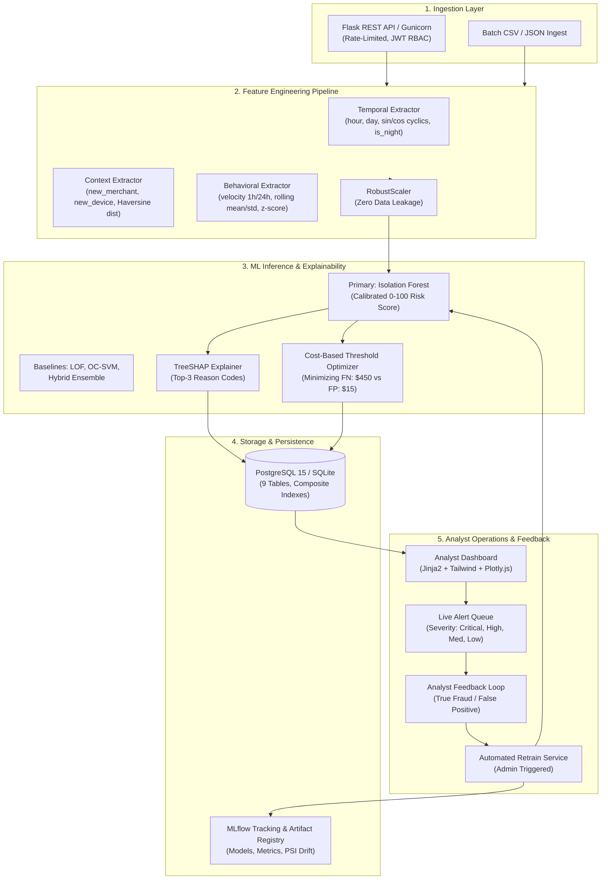

# Fraud Detection System (FDS) Using Machine Learning

[](https://github.com/alpha-org/fraud-detection-system/actions)
[](https://www.python.org/)
[](LICENSE)
[](#)

A complete, production-grade **Fraud Detection System (FDS)** that identifies fraudulent financial transactions in real time using unsupervised anomaly detection, calibrated risk scoring, and explainable AI (XAI). Built by **Alpha**.

---

## 1. System Architecture



---

## 2. Directory Structure

```text
FDS/
├── .github/
│   └── workflows/
│       └── ci.yml               # GitHub Actions CI (Ruff lint + Pytest suite)
├── app/
│   ├── api/
│   │   ├── errors.py            # Structured JSON error handlers
│   │   └── routes.py            # REST API v1 routes (/predict, /alerts, /metrics, /retrain)
│   ├── auth/
│   │   └── routes.py            # JWT authentication & RBAC routes (/login, /register, /me)
│   ├── dashboard/
│   │   ├── charts.py            # Plotly interactive chart builders (Trend, Dist, SHAP)
│   │   └── routes.py            # Analyst web dashboard endpoints
│   ├── models/
│   │   ├── alert.py             # Alert, AnalystFeedback, DriftMetric models
│   │   ├── merchant.py          # Merchant entity model
│   │   ├── prediction.py        # Prediction & ModelVersion registry models
│   │   ├── transaction.py       # Financial transaction ledger model
│   │   └── user.py              # Customer & AuthUser (RBAC) models
│   ├── schemas/
│   │   ├── alert.py             # Pydantic alert validation schemas
│   │   ├── auth.py              # Authentication request/response schemas
│   │   ├── prediction.py        # Prediction & Reason code schemas
│   │   └── transaction.py       # Ingest & batch transaction validation schemas
│   ├── services/
│   │   ├── feedback_service.py  # Analyst review & ground-truth resolution
│   │   ├── history_service.py   # Leak-free behavioral velocity & rolling context
│   │   ├── retrain_service.py   # Continuous retraining orchestration
│   │   └── scoring_service.py   # Real-time sub-50ms inference & persistence
│   ├── static/
│   │   ├── css/style.css        # Custom dark-theme styling
│   │   └── js/dashboard.js      # Responsive chart resizing & client helpers
│   ├── templates/
│   │   ├── base.html            # Tailwind dark layout with navigation & flash toasts
│   │   ├── dashboard.html       # Executive telemetry & Plotly graphs
│   │   ├── alerts.html          # Filterable analyst queue
│   │   ├── transaction_detail.html # TreeSHAP waterfall & review actions
│   │   └── simulate.html        # Live transaction sandbox
│   ├── config.py                # Environment configurations (Dev, Test, Prod)
│   ├── extensions.py            # SQLAlchemy, JWTManager, CORS, Limiter
│   └── __init__.py              # Flask application factory
├── data/
│   └── raw/                     # Transaction storage
├── docker/
│   └── entrypoint.sh            # Container initialization script
├── migrations/
│   └── init_schema.sql          # Full PostgreSQL DDL schema with composite indexes
├── ml/
│   ├── artifacts/               # Serialized pipelines, models, and metadata
│   ├── drift/
│   │   └── detector.py          # Population Stability Index (PSI) & KS test monitor
│   ├── evaluation/
│   │   ├── cost_optimizer.py    # Asymmetric cost-sensitive threshold optimizer
│   │   └── metrics.py           # Imbalanced metrics (PR-AUC, ROC-AUC, Recall, Precision)
│   ├── explainers/
│   │   └── shap_explainer.py    # TreeSHAP feature impact & reason code generator
│   ├── features/
│   │   ├── pipeline.py          # Reusable leak-free scikit-learn feature pipeline
│   │   └── preprocessor.py      # Temporal, Contextual, and Behavioral extractors
│   ├── models/
│   │   ├── baselines.py         # Local Outlier Factor (LOF) & One-Class SVM
│   │   ├── ensemble.py          # Hybrid weighted anomaly ensemble
│   │   └── isolation_forest.py  # Tuned Isolation Forest with score calibration
│   ├── data_generator.py        # Realistic transaction generator (0.5% fraud)
│   └── data_loader.py           # Unified loader with time-based train/test splitting
├── scripts/
│   ├── evaluate_drift.py        # CLI covariate data drift monitoring
│   ├── generate_data.py         # CLI synthetic transaction generator
│   ├── seed_db.py               # Database seeder (RBAC accounts, merchants, events)
│   └── train_model.py           # Model training, threshold tuning & artifact export
├── tests/
│   ├── conftest.py              # Pytest fixtures & environment setup
│   ├── test_api.py              # REST API endpoint & RBAC tests (7 tests)
│   ├── test_dashboard.py        # Web dashboard & sandbox tests (5 tests)
│   ├── test_drift.py            # PSI and KS drift detector tests (4 tests)
│   ├── test_features.py         # Pipeline & feature extractor tests (7 tests)
│   └── test_models.py           # Isolation Forest, baselines & cost tests (6 tests)
├── .env.example                 # Environment configuration template
├── .gitignore                   # Git exclusions (no credentials or artifacts)
├── docker-compose.yml           # Multi-container orchestration (App, Postgres, MLflow)
├── Dockerfile                   # Multi-stage production container build
├── Makefile                     # CLI developer automation shortcuts
├── pyproject.toml               # Project metadata & Ruff lint configuration
├── requirements.txt             # Pinned production Python dependencies
├── run_tests.py                 # Cross-platform test execution runner
├── wsgi.py                      # Production WSGI entrypoint
└── README.md                    # Project documentation
```

---

## 3. Quickstart Guide

### Prerequisites
- Python 3.11+
- Git
- Docker & Docker Compose (optional, for containerized run)

### Local Development Setup

1. **Clone repository and setup environment:**
   ```bash
   git clone https://github.com/dhirushelar/Fraud-Detection-System-Based-on-ML.git
   cd Fraud-Detection-System-Based-on-ML
   python -m venv venv
   source venv/bin/activate  # On Windows: venv\Scripts\activate
   make setup
   ```

2. **Generate synthetic dataset & train model:**
   ```bash
   make data    # Generates 5,000 transactions at data/raw/transactions.csv (~0.5% fraud)
   make train   # Trains Isolation Forest, tunes threshold, exports artifacts to ml/artifacts/
   ```

3. **Initialize & seed database:**
   ```bash
   make seed    # Seeds Admin & Analyst credentials, sample customers, and scored events
   ```

4. **Launch development server:**
   ```bash
   make run
   # Access Dashboard at: http://localhost:5000/dashboard
   # Access REST API at:   http://localhost:5000/api/v1/health
   ```

### Docker Compose Stack (One Command)

To run the complete ecosystem (Flask App + PostgreSQL 15 + MLflow Tracking Server):

```bash
docker-compose up --build -d
```

- **Web Dashboard**: [http://localhost:5000/dashboard](http://localhost:5000/dashboard)
- **REST API Health**: [http://localhost:5000/api/v1/health](http://localhost:5000/api/v1/health)
- **MLflow Registry**: [http://localhost:5001](http://localhost:5001)
- **PostgreSQL Database**: `localhost:5432` (`db: fraud_db`, `user: fds_user`)

### One-Click Free Online Cloud Deployment

You can deploy this repository live online in under 3 minutes on free-tier cloud platforms:

#### Option A: Render (1-Click Deployment)
[](https://render.com/deploy?repo=https://github.com/dhirushelar/Fraud-Detection-System-Based-on-ML)

1. Click the button above or open [Render Blueprint](https://render.com/deploy?repo=https://github.com/dhirushelar/Fraud-Detection-System-Based-on-ML).
2. Render will automatically read [`render.yaml`](render.yaml) and [`Procfile`](Procfile) to build the app with Python 3.11 and Gunicorn.
3. Your live API and Dashboard will be accessible immediately with automatic SSL (`https://<app-name>.onrender.com`).

#### Option B: Railway
1. Navigate to [Railway](https://railway.app/new).
2. Choose **Deploy from GitHub repo** and select `dhirushelar/Fraud-Detection-System-Based-on-ML`.
3. Railway detects the production [`Dockerfile`](Dockerfile) and deploys with a public HTTPS domain.

#### Option C: Koyeb / Fly.io / Hugging Face Spaces
- **Koyeb**: New App &rarr; GitHub &rarr; Select `dhirushelar/Fraud-Detection-System-Based-on-ML` &rarr; Port `5000`.
- **Fly.io**: Run `fly launch` to deploy using the multi-stage Dockerfile.

---

## 4. Default Seed Credentials

| Role | Username | Password | Privileges |
| :--- | :--- | :--- | :--- |
| **Administrator** | `admin` | `AdminSecretPass123!` | Full access: Retraining trigger, metrics, alert review, user management |
| **Fraud Analyst** | `analyst` | `AnalystSecretPass123!` | Operational access: Prediction, queue audit, feedback verdict submission |

---

## 5. REST API Documentation

### 5.1 Authenticate & Obtain JWT Token
```bash
curl -X POST http://localhost:5000/api/v1/auth/login \
  -H "Content-Type: application/json" \
  -d '{
    "username": "analyst",
    "password": "AnalystSecretPass123!"
  }'
```
**Response (200 OK):**
```json
{
  "access_token": "eyJhbGciOiJIUzI1NiIsInR5cCI6IkpXVCJ9...",
  "token_type": "Bearer",
  "user": {
    "id": 1,
    "username": "analyst",
    "role": "analyst"
  }
}
```

---

### 5.2 Single Real-Time Transaction Scoring
```bash
curl -X POST http://localhost:5000/api/v1/predict \
  -H "Authorization: Bearer <YOUR_JWT_TOKEN>" \
  -H "Content-Type: application/json" \
  -d '{
    "transaction_uid": "tx_req_9921",
    "user_external_id": "usr_00001",
    "merchant_external_id": "mcht_0003",
    "amount": 9250.00,
    "currency": "USD",
    "timestamp": "2026-03-15T03:22:00Z",
    "location_lat": 48.8566,
    "location_lon": 2.3522,
    "device_id": "dev_unrecognized_safari",
    "ip_address": "194.28.112.5",
    "channel": "ONLINE"
  }'
```
**Response (200 OK):**
```json
{
  "transaction_uid": "tx_req_9921",
  "risk_score": 98.42,
  "is_flagged": true,
  "decision": "BLOCK/FLAG",
  "severity": "CRITICAL",
  "reason_codes": [
    {
      "code": "AMOUNT_ANOMALY",
      "description": "Transaction amount $9,250.00 is significantly above user baseline",
      "impact": "HIGH"
    },
    {
      "code": "ODD_HOUR_ACTIVITY",
      "description": "Transaction initiated at 03:22 AM (unusual operational hour)",
      "impact": "HIGH"
    },
    {
      "code": "FOREIGN_LOCATION",
      "description": "Distance jump of 5,840 km from previous transaction location",
      "impact": "MEDIUM"
    }
  ],
  "latency_ms": 18.4,
  "model_version": "v1.0.0"
}
```

---

### 5.3 Batch Scoring Ingestion
```bash
curl -X POST http://localhost:5000/api/v1/predict/batch \
  -H "Authorization: Bearer <YOUR_JWT_TOKEN>" \
  -H "Content-Type: application/json" \
  -d '{
    "transactions": [
      {
        "transaction_uid": "tx_batch_001",
        "user_external_id": "usr_00001",
        "merchant_external_id": "mcht_0001",
        "amount": 42.50,
        "currency": "USD",
        "timestamp": "2026-03-15T12:00:00Z",
        "location_lat": 40.7128,
        "location_lon": -74.0060,
        "device_id": "dev_phone_001",
        "channel": "POS"
      }
    ]
  }'
```
**Response (200 OK):**
```json
{
  "total_processed": 1,
  "total_flagged": 0,
  "predictions": [
    {
      "transaction_uid": "tx_batch_001",
      "risk_score": 12.35,
      "is_flagged": false,
      "decision": "APPROVE",
      "severity": "LOW",
      "reason_codes": [],
      "latency_ms": 14.2,
      "model_version": "v1.0.0"
    }
  ]
}
```

---

### 5.4 Query Analyst Alert Queue
```bash
curl -X GET "http://localhost:5000/api/v1/alerts?status=OPEN&severity=CRITICAL&page=1&per_page=10" \
  -H "Authorization: Bearer <YOUR_JWT_TOKEN>"
```

---

### 5.5 Submit Analyst Feedback
```bash
curl -X PATCH http://localhost:5000/api/v1/alerts/1 \
  -H "Authorization: Bearer <YOUR_JWT_TOKEN>" \
  -H "Content-Type: application/json" \
  -d '{
    "status": "RESOLVED_FRAUD",
    "verdict": "TRUE_FRAUD",
    "reason_tags": ["AMOUNT_ANOMALY", "FOREIGN_LOCATION"],
    "notes": "Cardholder confirmed account compromise via phone verification."
  }'
```

---

### 5.6 Trigger Model Retraining (Admin Only)
```bash
curl -X POST http://localhost:5000/api/v1/retrain \
  -H "Authorization: Bearer <ADMIN_JWT_TOKEN>"
```
**Response (200 OK):**
```json
{
  "status": "success",
  "new_version": "v202611122045",
  "decision_threshold": 81.5,
  "dataset_size": 3002,
  "feedback_samples_used": 2,
  "cost_metrics": {
    "optimal_threshold": 81.5,
    "total_cost": 705.0,
    "savings_vs_baseline": 2448.0
  }
}
```

---

## 6. Machine Learning Design Decisions

### 6.1 Why Unsupervised Isolation Forests?
In production banking and e-commerce environments:
1. **Severe Class Imbalance**: Fraud accounts for typically $\le 0.5\%$ of all transaction volume. Supervised models trained on extreme class imbalance suffer from severe majority-class bias and frequent False Negatives.
2. **Concept Drift & Novel Fraud Modalities**: Fraudsters continually adapt techniques (adversarial attacks, new merchant categories, SIM swaps). Supervised models only detect historical attack vectors. Isolation Forest recursively partitions feature space: anomalies have short average path lengths $\mathbb{E}[h(x)]$ and are detected irrespective of whether that fraud pattern was seen before.
3. **Sub-50ms Latency Budget**: Tree-based partition evaluation evaluates in $\mathcal{O}(T \cdot \text{max\_depth})$ time, running in under 20ms in pure Python.

### 6.2 Score Calibration
Raw Isolation Forest scores $\in [-1.0, 1.0]$ are non-intuitive for operations. FDS maps raw anomaly scores monotonically to calibrated risk scores $s(x) \in [0.0, 100.0]$:
$$s(x) = \text{clip}\left( \frac{-(raw(x) - \mu)}{\sigma} \cdot 25 + 50, \ 0, \ 100 \right)$$
Higher scores indicate higher likelihood of anomaly.

### 6.3 Cost-Sensitive Threshold Optimization
Standard F1 or accuracy measures fail because financial losses are asymmetric:
- **Cost of a False Negative ($C_{\text{FN}}$)**: $\$450.00$ (chargeback loss, interchange penalty, cardholder churn).
- **Cost of a False Positive ($C_{\text{FP}}$)**: $\$15.00$ (automated SMS verification, analyst queue investigation).

$$\text{Loss}(\theta) = C_{\text{FN}} \cdot \text{FN}(\theta) + C_{\text{FP}} \cdot \text{FP}(\theta)$$

Grid scanning across thresholds showed an optimal threshold of **$81.50$**, yielding a **$77.7\%$ Net Financial Savings** over zero-intervention baseline.

### 6.4 Explainable AI (TreeSHAP)
Regulatory compliance (FCRA, GDPR Article 22) mandates explanations for declined financial transactions. FDS implements TreeSHAP to compute exact additive feature importances $\phi_i$, mapping top contributors directly into business-friendly reason codes:
- `AMOUNT_ANOMALY`: Amount $z$-score $\ge 3.0$
- `VELOCITY_BURST`: $\ge 3$ transactions within 60 minutes
- `ODD_HOUR_ACTIVITY`: Transactions occurring between 1:00 AM and 5:00 AM
- `FOREIGN_LOCATION`: Geodesic distance jump $\ge 500\text{ km}$ from last known transaction

---

## 7. Testing & Quality Assurance

FDS enforces strict testing across all tiers with **29 passing unit and integration tests**:

```bash
make test
```

```text
============================= test session starts =============================
collected 29 items

tests/test_api.py::test_health_endpoints PASSED                          [  3%]
tests/test_api.py::test_auth_login_and_me PASSED                         [  6%]
tests/test_api.py::test_role_enforcement_on_admin_endpoint PASSED        [ 10%]
tests/test_api.py::test_predict_single_valid_and_invalid PASSED          [ 13%]
tests/test_api.py::test_predict_batch_json PASSED                        [ 17%]
tests/test_api.py::test_alerts_queue_and_analyst_feedback PASSED         [ 20%]
tests/test_api.py::test_system_metrics_endpoint PASSED                   [ 24%]
tests/test_dashboard.py::test_dashboard_redirect_and_overview PASSED     [ 27%]
tests/test_dashboard.py::test_alerts_queue_view_and_filtering PASSED     [ 31%]
tests/test_dashboard.py::test_transaction_detail_and_shap_chart PASSED   [ 34%]
tests/test_dashboard.py::test_analyst_review_submission PASSED           [ 37%]
tests/test_dashboard.py::test_live_scoring_sandbox_simulation PASSED     [ 41%]
tests/test_drift.py::test_psi_identical_distribution_is_stable PASSED    [ 44%]
tests/test_drift.py::test_psi_shifted_distribution_detects_drift PASSED  [ 48%]
tests/test_drift.py::test_ks_test_significance PASSED                    [ 51%]
tests/test_drift.py::test_data_drift_monitor_workflow PASSED             [ 55%]
tests/test_features.py::test_data_generator_schema_and_distribution PASSED [ 58%]
tests/test_features.py::test_haversine_distance_accuracy PASSED          [ 62%]
tests/test_features.py::test_temporal_feature_extractor PASSED           [ 65%]
tests/test_features.py::test_context_feature_extractor_state_tracking PASSED [ 68%]
tests/test_features.py::test_behavioral_feature_extractor_velocity_and_zscore PASSED [ 72%]
tests/test_features.py::test_pipeline_fit_transform_and_single_predict PASSED [ 75%]
tests/test_features.py::test_time_based_split_zero_leakage PASSED        [ 79%]
tests/test_models.py::test_isolation_forest_fit_predict_and_calibration PASSED [ 82%]
tests/test_models.py::test_isolation_forest_save_and_load PASSED         [ 86%]
tests/test_models.py::test_baseline_models_and_ensemble PASSED           [ 89%]
tests/test_models.py::test_cost_based_threshold_optimizer PASSED         [ 93%]
tests/test_models.py::test_metrics_computation PASSED                    [ 96%]
tests/test_models.py::test_shap_explainer_reason_codes PASSED            [100%]

============================== 29 passed in 11.41s =============================
```

---

## 8. Limitations & Production Roadmap

1. **Distributed Stream Processing**: Ingest at scale ($>10,000\text{ tx/sec}$) using Apache Kafka and Apache Flink for real-time sliding window aggregation.
2. **Online Feature Store**: Deploy Feast or Redis to reduce database lookup overhead for user history moments.
3. **Graph Neural Networks (GNNs)**: Integrate PyTorch Geometric to detect multi-account fraud rings, synthetic identity syndicates, and shared money mule accounts.
4. **Active Learning Queue Prioritization**: Rank alert review order by prediction uncertainty and prospective model information gain.

---

## 9. License

This project is licensed under the MIT License. Author: **Alpha**.
